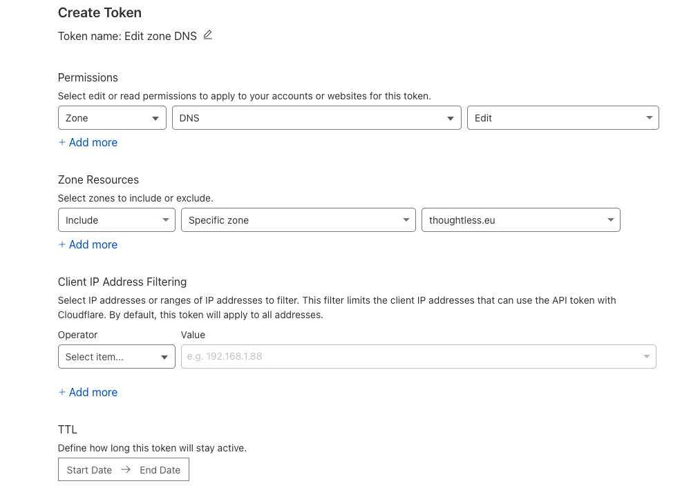

## Expose applications securely with Cloudflare Tunnel

`turing` sits at home behind a box whose ports 80 and 443 are already taken, so its services go out through a Cloudflare Tunnel. This is free, you only need a domain managed by Cloudflare.

### Cloudflare Tunnel

Install `cloudflared` and create the tunnel. It writes the credentials to `~/.cloudflared/<tunnel-id>.json`; never commit that file.

```bash
brew install cloudflared
cloudflared login
cloudflared tunnel create turing-cluster
```

Store the credentials in the cluster's Vault, under `kv/cloudflare`, property `credentials`:

```bash
export VAULT_CONTEXT=omni-turing
mise run vault:kv patch kv/cloudflare credentials=- < ~/.cloudflared/<tunnel-id>.json
```

The ExternalSecret [`turing/system/cloudflare/externalsecret.yaml`](https://github.com/qjoly/GitOps/blob/main/turing/system/cloudflare/externalsecret.yaml) turns it into the `cloudflare-tunnel-credentials` Secret (key `credentials.json`). The tunnel itself is the `cloudflare-tunnel` chart from `https://rubxkube.github.io/charts/`, deployed by [`turing/system/cloudflare/app.yaml`](https://github.com/qjoly/GitOps/blob/main/turing/system/cloudflare/app.yaml). It sends `*.thoughtless.eu` to Traefik (`https://traefik.traefik.svc.cluster.local:443`) over `http2`.

A CNAME pointing to `<tunnel-id>.cfargotunnel.com` reaches the cluster; turing's is `58c15097-f3b2-4ff7-a676-21bbeeea39d7.cfargotunnel.com`.

### External DNS

External DNS creates a Cloudflare record for each annotated Ingress.

[Create an API token in Cloudflare that can edit the DNS records](https://dash.cloudflare.com/profile/api-tokens) of the zone, then store it under `kv/cloudflare`, property `dnsToken`:



```bash
mise run vault:kv patch kv/cloudflare dnsToken=-
```

[`turing/system/external-dns/`](https://github.com/qjoly/GitOps/tree/main/turing/system/external-dns) holds the ExternalSecret (`cloudflare-api-key`, key `apiKey`) and the Application. Its records carry the `turing-` TXT prefix so they don't collide with the ones from `mocha/system/external-dns`.

Annotate an Ingress to publish it through the tunnel:

```yaml
apiVersion: networking.k8s.io/v1
kind: Ingress
metadata:
  annotations:
    external-dns.kubernetes.io/cloudflare-proxied: "true"
    external-dns.kubernetes.io/hostname: nginx.thoughtless.eu
    external-dns.kubernetes.io/target: 58c15097-f3b2-4ff7-a676-21bbeeea39d7.cfargotunnel.com
  name: nginx
  namespace: default
spec:
  ingressClassName: traefik
  rules:
  - host: nginx.thoughtless.eu
    http:
      paths:
      - backend:
          service:
            name: nginx
            port:
              number: 80
        path: /
        pathType: Prefix
```
