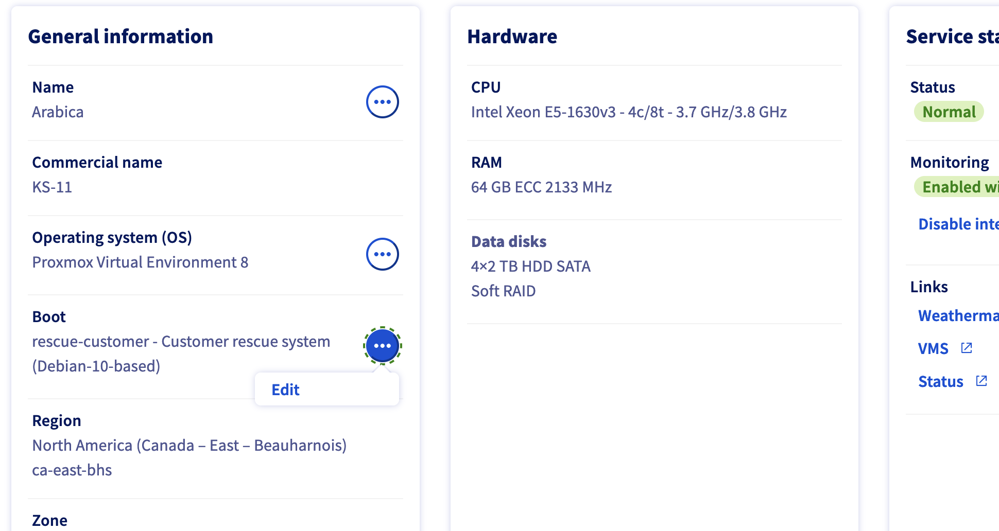
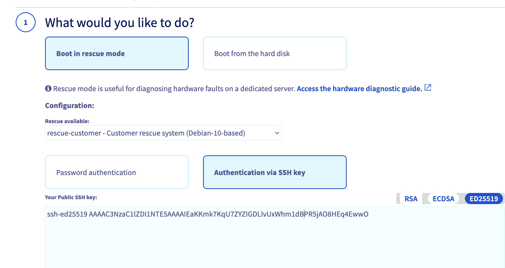
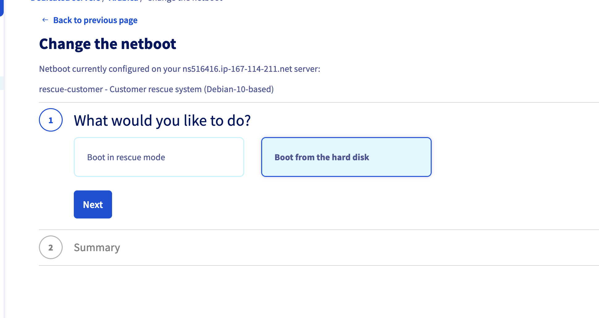

# Getting Started
# Location

In most cases, I suggest you to host your services at home. It's cheaper and you have more control over your data. However, if you don't have a good internet connection or you don't want to deal with the noise and heat of the servers, you can rent a server from a cloud provider.

I experimented with a few cloud providers and I found that [OVH](https://eco.ovhcloud.com/) is the best in terms of price and performance. They have a data center in multiple locations (Europe, North America, Asia) and provide many features like private network, Terraform support, and a good API.

*Keep in mind that I'm not affiliated with OVH and that we're in the case of a personal project.*

Let's see how to install our baremetal cluster on OVH.

*I didn't test vRack (private network between multiple servers) with OVH. If used it, please let me know how it went :smile:*.

## OVH install with Corium

Both OVH servers (`mocha` and `doppio`) run [Corium](https://github.com/Corium-OS/Corium), a bootc image around k0s, installed from the Rescue Mode.

After rebooting in Rescue Mode, you will receive an email with the credentials (or just the IP if you provided an SSH Key) to connect to the server.

From there, follow [Corium's rescue install guide](https://github.com/Corium-OS/Corium/blob/main/docs/install/rescue.md), then claim the node with `cctl` and its node document (`mocha/corium/mocha.yaml` or `doppio/corium/ks-stor.yaml`). The full procedure, including the `awaitConfig` setting you must not forget, is in [`doppio/README.md`](https://github.com/qjoly/GitOps/blob/main/doppio/README.md#install).

