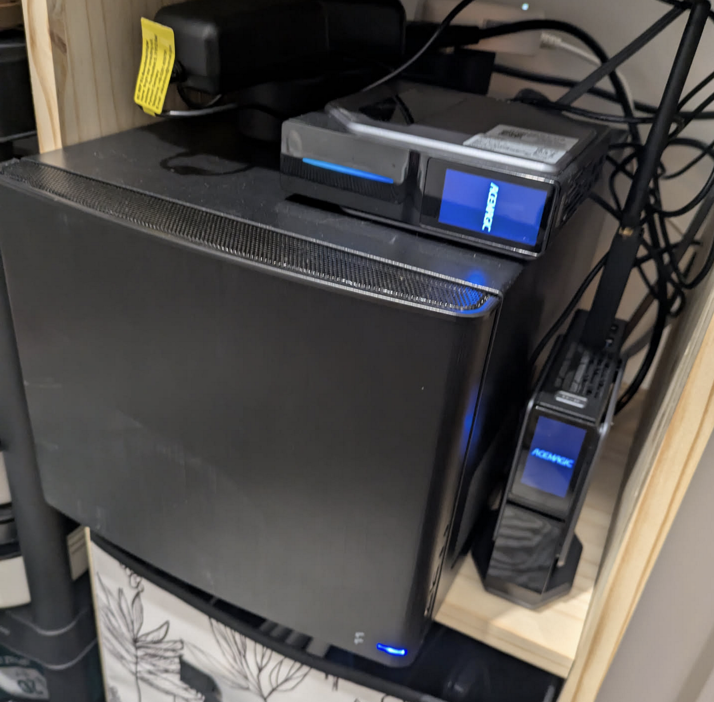

# Welcome aboard!

This is a collection of notes and guides that I have written to help me remember how to do things. I hope you find them useful too. Keep in mind that everything here is a work in progress and that it's mostly for personal use, so it might not be the best way to do things, however, many choices are made with ease of use in mind.

First things first, let's explain what a CloudLab is.

## What the heck is a CloudLab?

In opposition to a HomeLab, a CloudLab a server rented from a cloud provider. It's a great way to experiment with new technologies without the need to buy hardware and deal with the noise and heat of the servers.

In my personal case, I have both a Homelab and a CloudLab. I use the CloudLab to test new technologies and the Homelab to host sensitive data and services (`turing` is the Homelab cluster, `mocha` and `doppio` are the CloudLab clusters, both on OVH).

I have 2 n100 servers at home, both running Proxmox, connected to a 1G switch as well as my NAS.

As of October 2026 only `homelab-proxmox-01` is up: `homelab-proxmox-02` has been off the network
since the end of September and the two are no longer a PVE cluster, so each one is standalone.
See [`external/proxmox/README.md`](https://github.com/qjoly/GitOps/blob/main/external/proxmox/README.md)
for their telemetry and the current state of node 02.

*Sorry cable management enthusiasts, I'm not there yet.*

## Which technologies are used?

Like many people in the k8s-at-home community, I use Kubernetes to manage my services and prioritize Helm charts to deploy them. But many services / applications doesn't have a Helm chart (or the one provided doesn't respect my requirements) so I chose [to write my own templates](https://github.com/RubxKube/common-charts/) (If you start looking at my configuration, you will sometimes see `common-charts` instead of the official Helm chart).

The Homelab cluster runs [Talos](https://talos.dev/), managed by a self-hosted [Omni](https://omni.siderolabs.com/tutorials/getting_started/) instance, which gives one interface, a gRPC proxy to every Kubernetes API and RBAC. Its template is [`turing/template.yaml`](https://github.com/qjoly/GitOps/blob/main/turing/template.yaml), applied with `omnictl`.

The CloudLab servers run [Corium](https://github.com/Corium-OS/Corium) (bootc + k0s), driven with `cctl` from one node document per server (e.g. [`mocha/corium/mocha.yaml`](https://github.com/qjoly/GitOps/blob/main/mocha/corium/mocha.yaml)).

Here are just a few of the technologies and applications I use :
- [**Omni** (Self-hosted)](https://www.siderolabs.com/platform/saas-for-kubernetes/) : Manage the Talos nodes (`turing`).
- [Cilium](https://cilium.io/) as CNI and LB (ARP mode)
- [ArgoCD](https://argoproj.github.io/argo-cd/) to manage the GitOps workflow
- [Traefik](https://traefik.io/) for Ingress management
- [Cert Manager](https://cert-manager.io/) for TLS certificates.
- [Rook](https://rook.io/) (Ceph) and [csi-driver-nfs](https://github.com/kubernetes-csi/csi-driver-nfs) for the NAS (**`turing`**).
- [OpenEBS](https://openebs.io/): LVM on `mocha`, ZFS on `doppio`.
- [External Secrets](https://external-secrets.io/latest/) to fetch secrets from a remote store.
- [OpenBao](https://openbao.org/) (through bank-vaults) as the secret store, one per cluster.
- [Cloudflare Tunnels](https://developers.cloudflare.com/cloudflare-one/connections/connect-networks/) to expose services to the internet (**`turing`**).
- restic CronJobs to back up databases and OpenBao to S3 (**`mocha`**).
