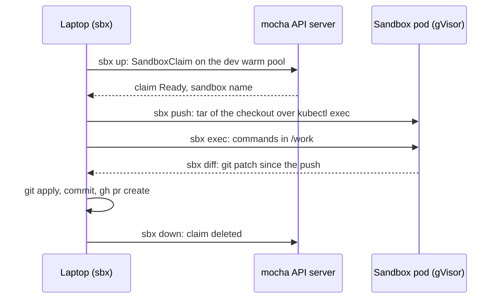

# Sandboxes

Disposable sandboxes on mocha where a local agent (or I) can build, run tests and browse the web
without touching my laptop. The code stays on my disk: a sandbox gets a copy, and what it changes
comes back as a git patch. git pushes and `gh` only run locally.

> **Warning:** the agent-sandbox controller and the `gvisor` RuntimeClass are installed on mocha by
> hand, not by this repository. `mocha/apps/sandboxes` only holds the template and the warm pool.

## How it fits together



- **Isolation**: every pod runs under gVisor. The network policy managed by agent-sandbox allows
  internet egress and nothing inside the cluster. The pod gets no service account token.
- **Storage**: no live mount. The checkout is copied in and changes come back as a patch, so builds
  run on the sandbox disk at full speed and nothing lives only in the cluster.
- **Credentials**: none in the sandbox. Anything that needs GitHub happens locally on the applied patch.

## Install

```bash
ln -s ~/code/perso/GitOps/mocha/apps/sandboxes/sbx ~/.local/bin/sbx
ln -s ~/code/perso/GitOps/mocha/apps/sandboxes/skill ~/.claude/skills/sbx
```

`sbx` talks to mocha through `mocha/kubeconfig` and the `mocha` context, whatever the current
context is. `SBX_KUBECONFIG`, `SBX_CONTEXT` and `SBX_NAMESPACE` override them.

The skill tells Claude Code when to reach for a sandbox and how to use it.

## Usage

```bash
n=$(sbx up)                        # claim a sandbox, prints its name
sbx push "$n" .                    # replace /work with the checkout
sbx exec "$n" -- bash -c 'mise install && make test'
sbx diff "$n" | git apply          # bring the changes back
sbx down "$n"
```

| Command | Effect |
|---|---|
| `up [name]` | Claims a sandbox and waits until it is ready. It is deleted after 4 h, or `SBX_TTL` seconds. |
| `push <name> [dir]` | Sends tracked and untracked files plus `.git`, minus gitignored ones. Local uncommitted edits are part of the baseline. |
| `exec <name> -- cmd…` | Runs argv in `/work`, stdin forwarded. Use `bash -c` for pipes and globs. |
| `diff <name>` | Prints a binary-safe patch of everything changed since the push. |
| `down <name>` / `ls` | Deletes / lists sandboxes. |

Build artifacts are gitignored, so they are not in the patch. Stream them back with tar:

```bash
sbx exec "$n" -- tar czf - -C /work dist | tar xzf -
```

For parallel tasks, give each sandbox its own `git worktree` so patches do not collide.

## Inside a sandbox

- `buildpack-deps:trixie` as root: compilers, git, curl, python3, and `apt-get` works.
- mise is installed when the pod starts, and the sandbox is only handed out once that is done.
  `mise install` picks up the repo's `mise.toml`; `mise use -g node@22` installs anything else.
- Up to 4 CPU and 8 GiB of RAM, 30 GiB of disk.
- gVisor keeps the root filesystem in RAM, so `/work`, `/root` and `/tmp` are on disk. Write anywhere
  else and it counts against the memory limit.

One sandbox always waits in the warm pool and is handed out within seconds. The others start cold in
about 6 seconds, mise download included.

## Troubleshooting

- `sbx up` hangs: run `sbx ls`, then
  `kubectl --kubeconfig mocha/kubeconfig --context mocha get ns`, which may need a browser for the
  OIDC login.
- `git apply` refuses the patch: the checkout moved since the push. Try `git apply --3way`.
- `mise: command not found`: the download from mise.run failed when the pod started. Install it
  with `sbx exec "$n" -- bash -c 'curl -fsSL https://mise.run | sh'`.
