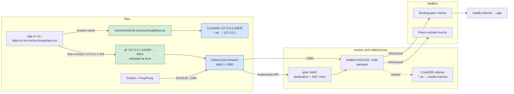

# netbird-jump

Reach NetBird-only services (`*.nb.mocha.thoughtless.eu`) from a machine where
the NetBird client can't be installed: an unprivileged NetBird peer (netstack
mode) runs in mocha and exposes a SOCKS5 proxy, reached with
`kubectl port-forward`.

```
Firefox + FoxyProxy ──SOCKS5──▶ kubectl port-forward ──▶ netbird-jump pod ──NetBird──▶ traefik-internal / peers
```

## Prerequisites

- `kubectl` with the [kubelogin](https://github.com/int128/kubelogin) plugin
  (`kubectl oidc-login`).
- [`mocha/kubeconfig`](../../kubeconfig): logs in through authentik. Port-forward
  needs the authentik `Admins` group, the only one bound in mocha.
- Outbound access to `5.196.80.72:6443`.

## Use it

1. Open the tunnel and keep it running. It drops on idle and when the pod
   restarts, hence the loop:

   ```bash
   export KUBECONFIG=mocha/kubeconfig
   while true; do
     kubectl -n netbird-jump port-forward deploy/netbird-jump 1080:1080
     sleep 1
   done
   ```

2. In FoxyProxy (Firefox), add a proxy:

   | Field | Value |
   |---|---|
   | Type | SOCKS5, not HTTP |
   | Hostname / Port | `127.0.0.1` / `1080` |
   | Proxy DNS | **on**: the pod resolves the names |

   Add an include pattern to it: type Wildcard (not Reg Exp),
   `*.nb.mocha.thoughtless.eu`, without scheme. Then switch FoxyProxy to
   "Proxy by Patterns", so only those hosts use the tunnel.

3. Browse `https://check.nb.mocha.thoughtless.eu/` (whoami, from
   [`netbird-check`](../netbird-check)), or check from a shell:

   ```bash
   curl --socks5-hostname 127.0.0.1:1080 https://check.nb.mocha.thoughtless.eu/
   ```

## Every app, without a proxy (macOS, admin rights)

For CLIs and apps without proxy support. Only `*.nb.mocha.thoughtless.eu` is
affected, and it still goes through NetBird: a gost sidecar in the jump routes
each connection by TLS SNI (or HTTP Host) through the SOCKS5 proxy.

Green is installed once by `nb:setup`, blue runs with `nb:tunnel`.



Once, from the repo (asks for sudo): `mise install && mise run nb:setup`.
It writes `/etc/resolver/nb.mocha.thoughtless.eu` and a pf redirect
`127.0.0.1:443/80 → 8443`, reloaded at boot. `mise run nb:teardown` undoes it.

Then, whenever needed: `mise run nb:tunnel` (Ctrl-C to stop). It also
forwards 1080, so FoxyProxy keeps working without the loop of step 1.

```bash
curl https://check.nb.mocha.thoughtless.eu/
```

- `dig` and `nslookup` ignore `/etc/resolver`: check with
  `dscacheutil -q host -a name check.nb.mocha.thoughtless.eu`.
- Firefox DNS over HTTPS bypasses it too: add `nb.mocha.thoughtless.eu` to
  `network.trr.excluded-domains`, and turn FoxyProxy off for that pattern.

## Troubleshooting

| Symptom | Cause |
|---|---|
| Connection refused on 127.0.0.1:1080 | The port-forward is down: see step 1 |
| `Empty reply from server` | Plain HTTP sent to the SOCKS port: proxy type is HTTP, or `curl` without `--socks5-hostname` |
| Timeout or 404 | Proxy DNS is off: the public wildcard `*.mocha.thoughtless.eu` answers instead |
| Timeout with Proxy DNS on | The NetBird path: check the router conntrack in `netbird-operator`. The ClusterIP only answers forwarded traffic because Cilium has `socketLB.hostNamespaceOnly` (`mocha/corium/mocha.yaml`) |

## Add a service

Nothing to do for an Ingress of class `traefik-internal`: netstack mode has no
NetBird DNS, so a CoreDNS sidecar ([`manifests/Corefile`](manifests/Corefile))
resolves every `*.nb.mocha.thoughtless.eu` name to traefik-internal.

An app outside this cluster needs its NetBird IP in that zone block, before the
`template` lines:

```
hosts {
    100.92.1.2 app.nb.mocha.thoughtless.eu
    fallthrough
}
```

The peer joins the `users` NetBird group (setup key `k8s-netbird-jump`,
`kv/netbird` `jump_setup_key`), so it gets the same access as your devices.
